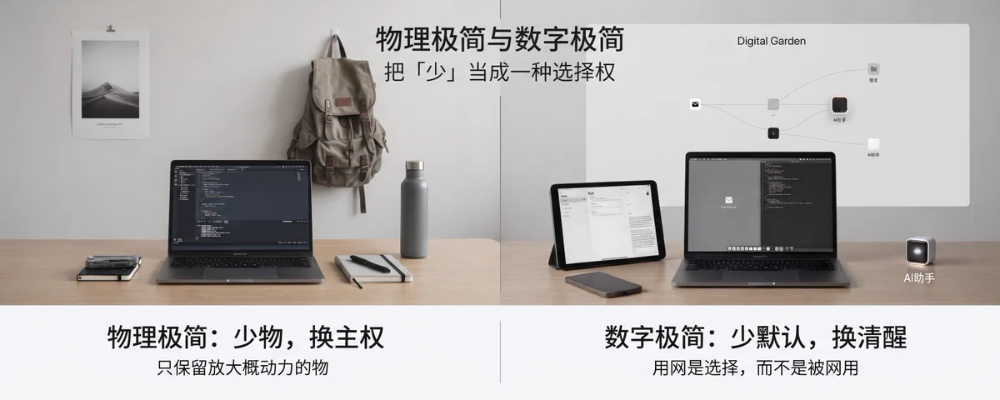

*本文根据 Vitalik 思想整理衍生。*

把「少」当成一种选择权：少物是为了更自由，少数字噪音是为了更清醒。

极简不是苦行，也不是炫耀「我有多空」。它是故意减少默认依赖，把注意力、时间和决定权留在自己手里。

- 物理极简回答：我需要随身带着多少东西？
- 数字极简回答：我允许多少软件、网络和算法替我做选择？

少，不是目的；可逆的选择权，才是目的。

## 一、物理极简：少物，换主权

物理极简流行于 2000–2010 年代：一台电脑替代成堆物理工具，背包客的生活方式成为可能。

它的核心不是「拼命扔东西」，而是把资产从“占空间、要维护、拖累移动”的形态，换成“可复用、可带走、可替代”的形态。

- 少一件家具 = 少一份搬家成本
- 少一堆专用器材 = 用通用工具完成更多事

**极简成熟版的核心尺度**

- 少占有：降低维护与决策成本。
- 高复用：一件工具覆盖多场景。
- 可带走：生活状态不绑死在某一间房、某一城。
- 有边界的留：保留真正带来自主与安全的物（如备用电源、离线资料）。

成熟标准：物服务于行动，而不是行动服务于物。

## 二、数字极简：少默认，换清醒

数字极简针对的是另一套「默认吸力」：推荐流、常开蜂窝、暗黑模式。目标不是戒网，而是让每一次联网、刷屏都变成有意识的选择。

> “Digital minimalism is about being intentional about ways that you access digital technology, making each use a conscious choice rather than something that you get sucked into by default.” — Vitalik Buterin, Digital minimalism (2026)

**三层实验框架**

1. 社交层：保留平台信息价值，削弱算法漩涡（少用官方推荐流，限定刷屏时段）。
2. 连接层：默认飞行模式 / 少开蜂窝，优先本地地图与离线知识。
3. 界面层：少依赖网页超级 App，多用本地工具、命令行或 AI 拼装的小工具，减少追踪。

时代变了：本地软件质量与 AI 让「离线能办事」「自然语言指挥小工具」成为现实。减负与必要，在此时叠在了一起。

## 三、两套极简的同构对照

| 维度 | 物理极简 | 数字极简 |
| --- | --- | --- |
| 减掉什么 | 闲置物、重复物、移动负担 | 默认刷屏、常开联网、不必要追踪 |
| 换来什么 | 空间、流动性、更低维护 | 注意力、情绪稳定、隐私与自主 |
| 技术前提 | 电脑与互联网替代成堆实物 | 本地软件、离线数据、AI 辅助小工具 |
| 常见误区 | 为少而少，丢掉自主资产 | 戒断表演，或换一个更耗神的新 App |

两者共用一条底层规则：用新技术降低「过简朴生活」的成本。

## 四、对生活的启发

**值得留下的习惯**

- 先清默认：通知、自动播放、打开手机就进的那个 App。
- 给数字设入口：某天刷、某客户端发、某时段回消息。
- 给物理设上限：一个抽屉、一个包、一个货架装得下就够。
- 留出空白：走路、等人、睡前不填满屏幕。

**容易踩的坑**

- 做成身份表演，越晒越焦虑。
- 砍掉备用与安全冗余（药、证件副本）。
- 用「又下了一个效率 App」假装在减负。
- 对家人同事零沟通突然失联，把极简变成冒犯。

成功的标准很朴素：你会不会更常觉得「今天的时间是我的」。

## 五、对工作的启发

工作里的极简，不是少干活，而是少被工具链与信息流消耗。

- 物理侧：桌面只留当下任务需要的纸笔与设备，其余进柜，减少视觉噪音。
- 数字侧：把「信息输入」和「深度输出」拆开——批处理消息，成块时间关掉群聊。

**减少摩擦的微习惯**

- 同一类任务固定同一套工具，拒绝「再试一个新协作软件」。
- 模板化重复决策：周报结构、会议纪要字段。
- 能本地完成的不丢进网页；能异步的不开会。

## 六、怎么开始：选一处减负

不要一次改革人生。选一个你会每天碰到的摩擦点，试两周：

1. 点名一个默认：睡前刷推荐、工作台十个标签页、桌上堆着半个月快递盒。
2. 设计一个更轻的替代：换客户端、换时段、换飞行模式、换本地笔记。
3. 设观察指标：睡眠是否更好、深度工作是否更长、焦虑是否更少。
4. 保留逃生口：紧急联系、关键会议——极简要可逆，不要把自己锁死。
5. 喜欢就扩一层：从社交到连接，或从书桌到衣柜。

物理极简让人轻装移动；数字极简让人清醒停留。

在技术足够强大的今天，你还愿不愿意把生活的方向盘，交给那些并不以你的长期利益为目标的默认设置？

**延伸阅读**

- Digital minimalism（Vitalik Buterin, 2026）
- What is in my backpack（Vitalik Buterin, 2022）

---

— foggie ｜ ZK Labs 杂谈 ｜ 2026-11-02

> 原文首发于 X（2026-11-02）：[物理极简与数字极简：拿回你生活的默认设置权](https://x.com/shangu365/article/2117276122123505933)
