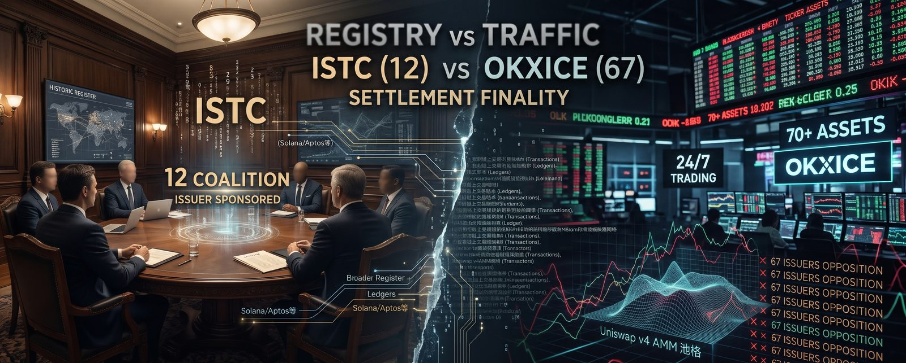

## 一、12 家坐上主桌，67 家拒绝上车

华尔街的股票代币化战场，正在出现两组截然不同的数字。
**12 与 67。**

12，是 Issuer Token Coalition（ISTC，发行人背书代币联盟，注：9月成立时官方称为 Issuer Sponsored Token Coalition）最新的成员数量。
67，是截至 11 月 5 日，向 OKXICE 提出相关代币化交易异议的上市公司数量。

11 月 17 日，Bullish 与 Equiniti 宣布，DRW、Flow Traders、SoFi 和 Superstate 加入 ISTC。这个 9 月 24 日才成立的行业联盟，不到两个月便扩张至 12 家。真正值得关注的不是多了四张椅子，而是坐上椅子的都是谁：DRW 和 Flow Traders 是做市与风险定价巨头；SoFi 掌握零售金融分发渠道与稳定币支付能力；Superstate 提供链上证券登记与代币化基建。

它们共同指向一个硬核逻辑：**股票代币化不缺发 Token 的技术，缺的是一套让发行人、券商、做市商和投资者敢于押注其确定性的市场基础设施。**

而 67 这个数字，来自完全不同的推进方式。
OKXICE 最初试图利用美国 SEC 的 Innovation Exemption，通过提前通知发行人、允许其在规定期限内提出异议的“默许制”，将第三方代币化股票强行拉入链上市场。结果是，大量上市公司明确说“不”。

但商业博弈并未停滞。11 月 11 日，OKX 宣布计划于 11 月 23 日正式启动 OKXICE，首批提供超过 70 项资产，包括 Circle、Coinbase、Robinhood、Strategy 等公司相关证券，以及 59 只 Direxion ETF。

67 家的反对没有让 OKXICE 停摆，却倒逼其重构了首发阵容。这才是两条路线最值得玩味的交锋：**发行人的态度，已经开始实质性剥夺或赋予交易场所的资产流动性。**

## 二、纽交所 Boardroom：6100 万股转移背后的结算幻觉

故事要回到 10 月 27 日。那天下午，前纽交所总裁、现 Bullish CEO Tom Farley 与 Equiniti CEO Dan Kramer 在纽约证券交易所 Boardroom 举行了一场闭门会。贝莱德、富达、Invesco、moomoo 等机构代表悉数在列。

活动高潮是 Farley 和 Kramer 在 Solana 公链上演示了 6100 万股代币化 Bullish 预留股份的转移，数秒完成。这是一场极具视觉冲击力的演示，但它证明的仅仅是：在过户代理参与下，证券的链上表征与转移可以同权威登记系统握手。

**它绝不意味着，所有链上交易都已经实现了法律意义上的秒级最终结算（Settlement Finality）。**

把“转账速度”等同于“结算终局”，是目前市场最大的认知误区。一笔代币化股票交易必须跨越四道生死线：

1. **技术共识**：链上交易是否达到防重组的确认要求？
2. **权利交付**：接收代币的地址，是否依法被确权为真实证券持有人？
3. **券款对付（DvP）**：证券交付与资金（如稳定币）支付，能否严丝合缝地同步完成？
4. **异常仲裁**：面对黑客攻击、分叉、司法冻结或除权除息，哪一套记录拥有绝对的法律终局效力？

如果链上显示成交，但法定名册拒绝确认，投资者拿到手的就是一张无法行权的废纸。这也是 Equiniti 路线的真正壁垒——把区块链的野蛮账本，强行拴入有法律责任主体的股东登记体系中。正如 Kramer 在会上那句定调：**“You can't tokenize trust.”**（信任不能靠铸造一个 Token 自动产生。）

## 三、12 家联盟的底牌：重构流动性经济学

ISTC 的 12 家成员，正在试图搭建一套能经受宏微观压力的运转体系：

* **第一层：证券权利与权威登记（Equiniti、Superstate）**。确立链上地址、受益所有权记录与发行人主名册之间的互操作映射规则。
* **第二层：交易与市场接入（Bullish、Alpaca、Apex、DriveWealth）**。提供券商接入、账户服务与合规资产持有。
* **第三层：做市与风险定价（DRW、Flow Traders、QRT）**。这是最懂交易微观结构的一环。
* **第四层：零售分发与链上资金（SoFi、Vertalo、zerohash）**。1710 万会员和 SoFiUSD 提供潜在的出入金与流量通道。

这里必须穿透来看第三层。加密交易员对 7×24 小时习以为常，但美股的流动性经济学完全不同。周二下午，美股现货市场开盘，做市商可以依靠底仓、期权或相关衍生品平滑 Delta 敞口。**但到了周日凌晨呢？**

纽约休市，传统对冲工具彻底停摆。做市商如果继续在链上双向报价，就必须用真金白银裸扛更长时间的库存敞口、隔夜跳空风险与单边信息套利。周末生成一个价格不难，难的是如何覆盖高昂的风险补偿金。DRW 和 Flow Traders 的入局，价值不在于盲目提供紧价差，而是利用其强大的跨市场库存管理能力，对这些极端风险进行系统性定价。

## 四、OKXICE 的突围：交易流量的野蛮生长

视线切回 OKXICE。SEC 的 Innovation Exemption 并非只给发行人背书开绿灯，它同样为第三方代币化留出了豁免空间（附带发行人异议机制）。

苹果、微软、英伟达等 67 家巨头行使了否决权。但这并不代表他们永远拒绝代币化，而是拒绝在当下以第三方“默许”的方式被摆上 OKXICE 的货架。

在撞到名册南墙后，OKXICE 迅速转身，于 11 月 11 日宣布将采用 X Layer 上的 Uniswap v4 AMM 池启动交易，资产池切换为 Coinbase、Robinhood 及 59 只 Direxion ETF。

这揭示了一个残酷的行业真相：**第三方代币化在遭到抵制后，迅速向愿意主动参与的资产端靠拢。** OKXICE 与 ISTC 并不是你死我活的技术对立。ISTC 在啃最硬的骨头（发行人主导的标准基建），而 OKXICE 正在疯狂抢夺二级市场的全天候流动性与先发心智。

## 五、三个验证锚点：不听口号，只看数据

摒弃阵营执念，未来几个月的走向将由以下三个锚点决定：

**锚点一：外部发行人能否规模化入局？**
盯紧 ISTC 能否促成独立于 Bullish 之外的实体上市公司完成授权与名册对接。一个试点只是 PR，连续的规模化采用才是商业闭环的起点。

**锚点二：结算最终性标准能否落地？**
关注 ISTC 会否发布公开标准文本，特别是针对 DvP 机制、跨链对账以及停牌/分红等公司行动的处理细则。没有这些，联盟就只是一场高级饭局。

**锚点三：11 月 23 日 OKXICE 的实盘流动性考卷。**
这最贴近量化与投研的射程。观察其首个交易周与首个周末的数据：

* 正常时段与周末的有效价差（Spread）劣化程度；
* 固定头寸（如 10 万美元）的**价格冲击成本（Slippage）**；
* AMM 池在周末面对单边宏观消息时的**价格偏离度**，以及周一美股开盘后的**修复耗时**。

## 六、终局：谁能同时掌控名册与订单簿？

10 月 27 日的闭门演示，11 月 11 日的开盘预告，11 月 17 日的联盟扩军。股票代币化正在同时撕裂和缝合：上游的发行人急于收回资产上链的绝对控制权，下游的交易平台则在狂奔圈地全天候流动性。

单纯掌握名册，没有流动性，只是一个昂贵的 Excel 表格。单纯拥有全天候撮合，没有底层确权和风险承接，终究是沙上建塔。

真正的竞争，从来不是把股份搬上哪条链。**而是谁能同时掌握可信的证券权利登记、可执行的交易流动性，以及具有法律确定性的清结算体系。**

*本文事实核验：GlobeNewswire ISTC 扩员通稿（2026-11-17）、Bullish 官网通稿原文（2026-11-03）、Equiniti EQ Views 文章（2026-11-03/04）、SEC Release No. 34-106402（2026-09-17）、OKXICE 异议名单公告（2026-11-05）、OKX 上线公告（2026-11-11）。本文分析不构成任何投资建议，仅供市场微观结构研究参考。*
